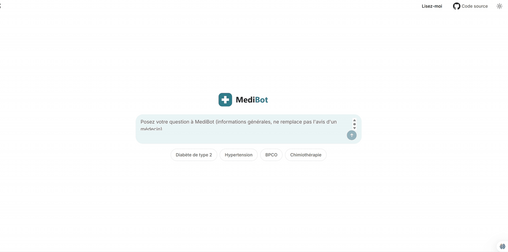
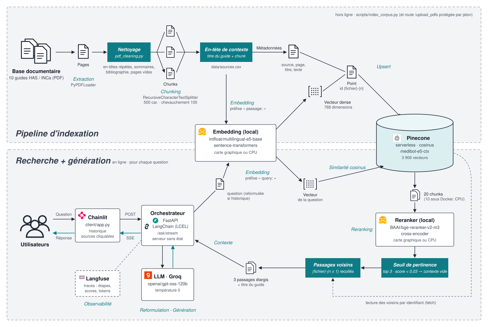

# MediBot — assistant médical RAG en français

MediBot répond à des questions de santé **à partir de guides officiels** de la Haute Autorité de Santé (HAS) et de
l'Institut national du cancer (INCa), en **citant ses sources** (document et page). Il refuse de répondre hors de
son corpus, ne pose pas de diagnostic et ne donne pas de posologie personnalisée.

Le projet couvre toute la chaîne d'un système RAG en production : indexation, recherche
vectorielle + reranking, génération en streaming, **évaluation mesurée** à chaque amélioration, observabilité,
tests, CI avec barrière d'évaluation et conteneurisation.



**Chiffres clés** : exactitude des réponses de 46 % à 78 %, faux refus de 15 % à 3 %, 100 % des garde-fous respectés,
chaque amélioration mesurée sur un jeu de test de 43 questions.

> Projet de démonstration : MediBot fournit des informations générales et ne remplace pas l'avis d'un professionnel de santé.

## Sommaire

- [Architecture](#architecture)
- [Résultats](#résultats)
- [Démarrage rapide](#démarrage-rapide)
- [Qualité et production](#qualité-et-production)
- [Limites connues](#limites-connues)
- [Corpus](#corpus)

## Architecture



Deux phases : l'**indexation**, faite une fois à l'avance (nettoyage, découpage, vectorisation, stockage dans Pinecone),
puis, pour chaque question, la **recherche et la génération** (reformulation, recherche vectorielle, reranking,
seuil de pertinence, passages voisins, réponse en streaming avec citations).

| Composant | Choix | Pourquoi |
|---|---|---|
| API | FastAPI, Pydantic, streaming SSE | validation des entrées, documentation `/docs`, réponse affichée au fil de l'eau |
| Orchestration | LangChain (LCEL) | chaîne composable : reformulation → recherche → génération |
| Embeddings | `intfloat/multilingual-e5-base` (local) | multilingue, gratuit, sans quota |
| Base vectorielle | Pinecone serverless | index managé, offre gratuite |
| Reranker | `BAAI/bge-reranker-v2-m3` (local) | cross-encoder multilingue : le plus gros gain mesuré |
| LLM | `openai/gpt-oss-120b` via Groq, température 0 | réponses déterministes, évaluations comparables |
| Évaluation | LLM juge `qwen3.8-27b` (autre famille que le modèle évalué) | métriques inspirées de RAGAS, sans biais d'auto-évaluation |
| Observabilité | Langfuse | trace de chaque question : reformulation, passages et scores, prompt, tokens, latence |
| Interface | Chainlit | client de l'API (aucune logique RAG côté client) |

## Résultats

Mesurés sur un jeu de test de 43 questions écrit à la main (faits, listes, langage de patient, questions
multi-documents, questions de suivi, hors sujet, pièges : diagnostic, posologie, injection de prompt).

| | Version initiale | Version actuelle |
|---|---|---|
| **Recherche** — bonne page dans les 3 premiers passages (hit@3) | 69,7 % | **87,9 %** |
| **Recherche** — rang moyen de la bonne page (MRR@3) | 0,581 | **0,828** |
| **Réponses** — fidélité au contexte (pas d'hallucination) | 0,864 | **0,939** |
| **Réponses** — exactitude (faits de la référence présents) | 0,460 | **0,784** |
| **Réponses** — rappel du contexte | 0,494 | **0,852** |
| Faux refus (« je n'ai pas trouvé » alors que la réponse existe) | 15,2 % | **3,1 %** (1 cas) |
| Comportements attendus (refus hors sujet, diagnostic, injection) | 90 % | **100 %** |

Version actuelle : évaluation complète à la date du 3 novembre 2026 ([`generation_20261103_165659.json`](data/eval/results/generation_20261103_165659.json)) ;
un cas sur 43 n'a pas pu être jugé (requête trop longue pour l'offre gratuite du juge, depuis l'élargissement du contexte).

Chaque amélioration a été mesurée séparément (résultats versionnés dans [`data/eval/results/`](data/eval/results/)) :

| Étape | Effet principal |
|---|---|
| Nettoyage des PDF (en-têtes répétés, sommaires, bibliographies) | hit@3 69,7 % → 75,8 % ; langage de patient 50 % → 83 % |
| Titre du document en en-tête de chaque passage | MRR 0,566 → 0,626 ; le LLM sait de quel guide vient chaque passage |
| **Reranking** par cross-encoder (20 candidats → 3) | hit@3 72,7 % → **87,9 %**, MRR 0,626 → **0,828** |
| Élargissement aux passages voisins | réponses coupées entre deux passages retrouvées ; rappel du contexte 0,60 → 0,86 |
| Consignes précisées (questions personnelles, sujet exact) | faux refus 15 % → 0 à 3 % selon les passages |
| Seuil de pertinence du reranker | question hors sujet bloquée avant le LLM (comportements 100 %) |

## Démarrage rapide

### Avec Docker (recommandé)

1. Copier le modèle de configuration, puis y renseigner les clés (Groq, Pinecone ; Langfuse facultatif) :

   ```bash
   cp serveur/.env.example serveur/.env
   ```

2. Construire l'image et lancer l'API et l'interface :

   ```bash
   docker compose up --build
   ```

3. Ouvrir l'interface sur http://localhost:8001 (documentation de l'API : http://localhost:8000/docs).

### Sans Docker

Prérequis : Python 3.12 et [uv](https://docs.astral.sh/uv/).

1. Installer les dépendances :

   ```bash
   uv venv
   uv pip install -r serveur/requirements.txt -r client/requirements.txt
   ```

2. Télécharger les 10 guides, puis les indexer dans Pinecone (nettoyage, découpage, embeddings) :

   ```bash
   python scripts/download_corpus.py
   python scripts/index_corpus.py
   ```

3. Lancer l'API (terminal 1) :

   ```bash
   cd serveur
   uvicorn main:app
   ```

4. Lancer l'interface (terminal 2) :

   ```bash
   cd client
   chainlit run app.py --port 8001
   ```

### Évaluer et tester

```bash
# Recherche : hit@k, MRR@k (sans LLM, environ 1 min)
python scripts/eval_retrieval.py

# Réponses : LLM juge (environ 30 min, consomme le quota Groq)
python scripts/eval_generation.py

# Tests unitaires (27 tests, sans clé d'API)
pytest
```

**Docker et carte graphique** : l'image tourne sur processeur (aucune carte graphique dans le conteneur). Le reranker
y est nettement plus lent : environ 10 s par question avec 10 passages reclassés, contre environ 4,5 s (20 passages)
en lançant l'API directement sur une machine équipée d'une carte graphique NVIDIA.

## Qualité et production

- **Tests** : nettoyage des PDF, retriever (reranking, seuil, passages voisins), citations, validation des requêtes.
- **CI** (GitHub Actions) : lint et tests à chaque push ; **barrière d'évaluation** : la CI échoue si le hit@3
  passe sous 80 % sur le vrai index.
- **Sécurité** : clés hors du code ; ajout de documents protégé par jeton d'administration ; messages d'erreur
  génériques côté client ; noms de fichiers assainis ; entrées validées (longueur, rôles de l'historique).
- **Serveur sans état** : l'historique de conversation est envoyé par le client ; un `session_id` regroupe les
  questions d'une conversation dans Langfuse.

## Limites connues

- **Tableaux** : l'extraction de texte des PDF aplatit les tableaux (une question sur la fréquence des dosages
  selon le stade de la maladie rénale échoue encore).
- **Seuil de pertinence** choisi sur le jeu de test lui-même, avec une marge étroite : un jeu de validation séparé
  serait nécessaire pour le confirmer. Plus généralement, 43 questions ne suffisent pas à départager des variantes
  proches (une question = 2 à 3 points de pourcentage).
- **Latence** : environ 4,5 s par question sur une petite carte graphique (le reranker représente 2 s) ; sur CPU
  (conteneur Docker), 10 candidats sont reclassés au lieu de 20.
- **Variabilité** : malgré la température 0, une même question peut recevoir une réponse légèrement différente d'une
  exécution à l'autre (ex. une question de patient sur les siestes, tantôt répondue, tantôt refusée).
- **Corpus** limité à 10 guides ; pas de lecture des images des PDF.

## Corpus

10 documents publics (HAS 2014–2025, INCa 2018–2025) : diabète de type 2, hypertension artérielle, BPCO,
insuffisance cardiaque, maladie rénale chronique, chimiothérapie, fatigue et cancer, mélanomes.
Liste et liens dans [`data/sources.csv`](data/sources.csv) ; les PDF ne sont pas redistribués dans ce dépôt.
